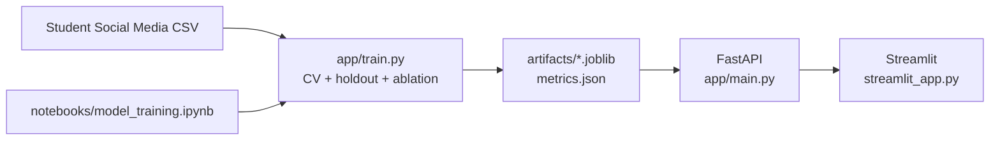

# Student Social Media & Wellbeing

Đồ án học máy gồm ba phần theo yêu cầu: notebook xây dựng mô hình, REST API
FastAPI không có giao diện, và ứng dụng Streamlit tương tác với API.

## Bài toán và dữ liệu

- Dữ liệu: `Student Social Media And Mental Health Impact.csv` (5.000 bản ghi).
- Bài toán: hồi quy dự đoán `Mental_Health_Score` trên thang điểm 0-10.
- Đầu vào: thông tin học tập, thói quen sử dụng mạng xã hội, giấc ngủ, vận động
  và mức căng thẳng.
- Chất lượng dữ liệu: 2 dòng trùng; 10 giá trị `Physical_Activity_Hours` âm;
  111 quốc gia nhưng 1.880 dòng là `"Other"`; target thực tế nằm trong 3.6-9.4.
- Tiền xử lý: One-Hot Encoding cho biến phân loại (`handle_unknown="ignore"`,
  đầu ra dense); giá trị vận động âm được chặn về 0 khi huấn luyện. CSV gốc không
  bị sửa.
- Chia tập đánh giá cố định 80/20 (random seed 42). Mô hình được chọn bằng
  5-fold cross-validation trên tập train; holdout 20% chỉ dùng để báo cáo.

## Kiến trúc



## Ánh xạ yêu cầu đồ án

| Yêu cầu | Nội dung | Tệp chính |
|---|---|---|
| Project 1 | Backend REST API, input mẫu, output JSON | `app/main.py`, `app/schemas.py` |
| Project 2 | Ứng dụng demo có UI, gọi API, tương tác người dùng | `streamlit_app.py` |
| Project 3 | Jupyter Notebook xây dựng mô hình | `notebooks/model_training.ipynb` |

## Kết quả mô hình

Mô hình được chọn bằng 5-fold CV trên tập train (thấp hơn RMSE là tốt hơn).

| Mô hình | CV RMSE (mean ± std) | CV R² |
|---|---|---|
| Random Forest (được chọn) | 0.4166 ± 0.0118 | 0.8918 |
| HistGradientBoosting | 0.4223 ± 0.0121 | 0.8888 |
| Linear Regression | 0.6035 ± 0.0127 | 0.7732 |
| Dummy (baseline) | 1.2690 ± 0.0248 | -0.0017 |

Hiệu năng holdout của Random Forest:

| MAE | RMSE | R² |
|---|---|---|
| 0.2854 | 0.3948 | 0.9101 |

Các chỉ số holdout ở trên là của mô hình huấn luyện trên 80% dữ liệu. Sau khi báo
cáo, artifact cuối được fit lại trên toàn bộ 5.000 dòng để phục vụ API; vì vậy
`training_rows` trong metadata là 5.000, còn metrics là của mô hình 80%.

Mức ảnh hưởng (permutation importance trên holdout, đơn vị ΔRMSE):

| Biến | Importance |
|---|---|
| `Avg_Daily_Usage_Hours` | 0.8765 |
| `Sleep_Hours_Per_Night` | 0.3412 |
| `Country` | 0.2349 |
| `Daily_Unlocks` | 0.0942 |
| `Most_Used_Platform` | 0.0495 |

Ablation `Stress_Level` (cùng giao thức CV/holdout):

| Biến thể | MAE | RMSE | R² |
|---|---|---|---|
| Có `Stress_Level` | 0.2854 | 0.3948 | 0.9101 |
| Bỏ `Stress_Level` | 0.2855 | 0.3978 | 0.9088 |

Bỏ `Stress_Level` gần như không đổi R²: tín hiệu chính đến từ giờ dùng mạng xã
hội và giấc ngủ, không phải từ biến căng thẳng. Chi tiết trong notebook và
[model card](docs/model_card.md).

## Cài đặt và chạy trên Windows

Mở PowerShell tại thư mục project:

```powershell
python -m venv .venv
.\.venv\Scripts\Activate.ps1
python -m pip install -r requirements.txt
```

`requirements.txt` đã pin đúng phiên bản dùng để tạo artifact (Python 3.14.8,
scikit-learn 1.9.1, pandas 3.1.0). Nếu dùng phiên bản Python khác, có thể cần
nới pin để pip tìm được wheel tương thích.

### 1. Huấn luyện mô hình

```powershell
python -m app.train
```

Lệnh tạo `artifacts/mental_health_model.joblib` và `artifacts/metrics.json`.
`metrics.json` chứa holdout metrics, bảng CV, feature importance và ablation.
Có thể truyền đường dẫn khác:

```powershell
python -m app.train --data "Student Social Media And Mental Health Impact.csv"
```

### 2. Chạy REST API

Trong một PowerShell:

```powershell
uvicorn app.main:app --reload
```

- Kiểm tra API: <http://127.0.0.1:8000/health>
- Thông tin mô hình: <http://127.0.0.1:8000/model-info>
- Tài liệu Swagger: <http://127.0.0.1:8000/docs>

Ví dụ yêu cầu `POST /predict`:

```json
{
  "age": 21,
  "gender": "Female",
  "country": "Vietnam",
  "academic_level": "Undergraduate",
  "most_used_platform": "Instagram",
  "purpose_of_use": "Education",
  "avg_daily_usage_hours": 4.0,
  "daily_unlocks": 120,
  "study_hours": 4.0,
  "physical_activity_hours": 1.0,
  "sleep_hours_per_night": 7.0,
  "stress_level": "Medium"
}
```

Ví dụ phản hồi:

```json
{
  "mental_health_score": 6.42,
  "score_scale": "0-10",
  "model_version": "1.1.0"
}
```

Điểm số ở trên chỉ minh họa định dạng; kết quả thực tế phụ thuộc mô hình đã
huấn luyện. API clamp mọi dự đoán về `[0, 10]`.

`GET /model-info` trả metadata huấn luyện (rút gọn):

```json
{
  "model_version": "1.1.0",
  "selected_model": "random_forest",
  "metrics": {"mae": 0.2854, "rmse": 0.3948, "r2": 0.9101},
  "cv_results": [{"model": "random_forest", "rmse_mean": 0.4166}],
  "feature_columns": ["Age", "Gender", "Country"],
  "feature_importance": [{"feature": "Avg_Daily_Usage_Hours", "importance": 0.8765}],
  "feature_importance_method": "permutation",
  "training_rows": 5000,
  "trained_at_utc": "..."
}
```

Muốn dùng artifact khác, đặt biến môi trường `MODEL_ARTIFACT_PATH` trước khi
khởi động API:

```powershell
$env:MODEL_ARTIFACT_PATH = "C:\path\to\model.joblib"
uvicorn app.main:app
```

### 3. Chạy ứng dụng giao diện

Giữ API đang chạy, mở PowerShell thứ hai tại thư mục project:

```powershell
.\.venv\Scripts\Activate.ps1
streamlit run streamlit_app.py
```

Giao diện có sidebar hiển thị version, mô hình được chọn, metrics và feature
importance; form có kịch bản mẫu để điền nhanh. Nếu API ở địa chỉ khác, đặt biến
môi trường `API_URL`:

```powershell
$env:API_URL = "http://127.0.0.1:8000"
streamlit run streamlit_app.py
```

### 4. Notebook

Mở `notebooks/model_training.ipynb` bằng Jupyter hoặc VS Code. Notebook thực hiện
khảo sát dữ liệu, kiểm tra chất lượng, EDA, so sánh 4 mô hình bằng CV, đánh giá
holdout, residual, feature importance, ablation và lưu cùng artifact mà API dùng.
Chạy lại toàn bộ notebook bằng dòng lệnh:

```powershell
python -m nbconvert --to notebook --execute --inplace notebooks/model_training.ipynb
```

### 5. Docker

```powershell
docker build -t student-wellbeing .
docker run -p 8000:8000 student-wellbeing
```

Image dùng `python:3.14-slim`, chỉ cài dependency runtime từ
`requirements-api.txt`, chạy bằng user không phải root, có `HEALTHCHECK`, và copy
artifact đã huấn luyện (không train lúc build). Lệnh build chưa được xác nhận trên
máy tác giả vì Docker daemon đang tắt; hãy chạy lại ở máy có Docker Desktop.

## Kiểm thử

```powershell
python -m pytest -q
```

Bộ test không phụ thuộc artifact commit sẵn: fixture tạo một dataset tổng hợp nhỏ
và trỏ `MODEL_ARTIFACT_PATH` vào artifact tạm. Có thêm guard test kiểm tra
artifact trong repo khớp `MODEL_VERSION` và danh sách feature.

## Cấu trúc thư mục

```
app/
  features.py      # tên cột, version, seed
  schemas.py       # Pydantic request/response
  train.py         # preprocessing, CV, chọn mô hình, ablation, lưu artifact
  main.py          # FastAPI: /health, /predict, /model-info
artifacts/         # model.joblib + metrics.json
notebooks/         # notebook xây dựng mô hình
tests/             # API, schema, training, artifact guard
streamlit_app.py   # giao diện demo
Dockerfile
requirements.txt
```

## Lưu ý sử dụng

Đây là đồ án/demo học máy dựa trên dữ liệu khảo sát, không phải công cụ chẩn đoán,
sàng lọc hay tư vấn sức khỏe tinh thần. Kết quả là ước lượng thống kê, không chứng
minh quan hệ nhân quả và không nên dùng để ra quyết định về cá nhân. Mô hình chỉ
được huấn luyện trên độ tuổi 18-24; API giới hạn tuổi trong phạm vi này. Riêng
`country` là chuỗi tự do, nên quốc gia chưa xuất hiện trong tập huấn luyện được
mã hóa an toàn như nhóm chưa thấy; các trường phân loại còn lại được giới hạn
bằng `Literal` và trả 422 nếu ngoài danh sách. Chất lượng dự đoán ngoài phân phối
không được đảm bảo. `Country` có permutation importance khá cao dù 1.880 dòng là
`"Other"`, nên không nên diễn giải đây là khác biệt thực sự giữa các quốc gia.

Xem thêm [docs/model_card.md](docs/model_card.md).
