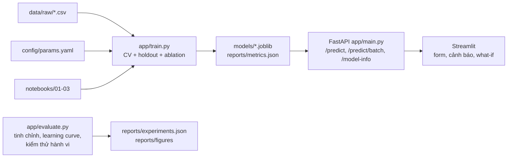

# Student Social Media & Wellbeing (v1.2.0)

Đồ án học máy gồm ba phần theo đề bài: notebook xây dựng mô hình, REST API FastAPI
không có giao diện, và ứng dụng Streamlit tương tác với API. Bản này gộp bản nộp
(v1.1.0) với các phần bổ sung theo tài liệu môn học; danh sách thay đổi ở
[docs/thay_doi_v1.2.md](docs/thay_doi_v1.2.md).

## Bài toán và dữ liệu

- Dữ liệu: `data/raw/Student Social Media And Mental Health Impact.csv` (5.000 bản ghi, tuổi 18-24).
- Bài toán: hồi quy dự đoán `Mental_Health_Score` trên thang 0-10.
- Chất lượng dữ liệu: 2 dòng trùng; 10 giá trị `Physical_Activity_Hours` âm (chặn về 0
  khi huấn luyện, CSV gốc không sửa); 111 quốc gia nhưng 1.880 dòng là `"Other"`,
  85 quốc gia có dưới 30 dòng, Vietnam chỉ 5 dòng.
- Chia 80/20 (seed 42). Chọn mô hình bằng 5-fold CV trên tập train; holdout chỉ để báo cáo.

## Kiến trúc



## Ánh xạ yêu cầu đồ án

| Yêu cầu | Nội dung | Tệp chính |
|---|---|---|
| Project 1 | REST API, input mẫu, output JSON kèm cảnh báo | `app/main.py`, `app/schemas.py` |
| Project 2 | Ứng dụng demo có UI, gọi API, what-if | `streamlit_app.py` |
| Project 3 | Notebook khám phá, xây dựng mô hình, suy luận | `notebooks/01_eda.ipynb`, `02_model_training.ipynb`, `03_inference.ipynb` |

Đối chiếu với toàn bộ tài liệu môn học: [docs/yeu_cau_va_doi_chieu.md](docs/yeu_cau_va_doi_chieu.md).

## Kết quả mô hình

| Mô hình | CV RMSE (mean ± std) | CV R² |
|---|---|---|
| Random Forest đã tinh chỉnh (được chọn) | 0.3932 ± 0.0134 | 0.9036 |
| HistGradientBoosting | 0.4223 ± 0.0121 | 0.8888 |
| Linear Regression | 0.6035 ± 0.0127 | 0.7732 |
| Dummy (baseline) | 1.2690 ± 0.0248 | -0.0017 |

Holdout của mô hình được chọn: MAE 0.2761, RMSE 0.3762, R² 0.9184
(R² hiệu chỉnh 0.9057). Bản 1.1.0: MAE 0.2854, RMSE 0.3948, R² 0.9101.

Permutation importance trên holdout (ΔRMSE):

| Biến | Importance |
|---|---|
| `Avg_Daily_Usage_Hours` | 0.5487 |
| `Sleep_Hours_Per_Night` | 0.3736 |
| `Country` | 0.2093 |
| `Daily_Unlocks` | 0.1598 |
| `Most_Used_Platform` | 0.0541 |

Bỏ `Stress_Level`: R² 0.9184 → 0.9184 (gần như không đổi). Chi tiết, kiểm thử hành vi
và learning curve trong `reports/experiments.json`, [docs/model_card.md](docs/model_card.md) và báo cáo
`Bao_cao_do_an_ML_v2.docx`.

## Cấu trúc thư mục

```
app/                 # features, preprocess, schemas, train, evaluate, main (API)
config/params.yaml   # siêu tham số, ngưỡng cảnh báo, ngưỡng độ trễ
data/
  raw/               # dữ liệu gốc, không chỉnh sửa
  processed/         # kết quả từng bước tiền xử lý (python -m app.preprocess), chỉ để xem
  external/          # dành cho dữ liệu ngoài (hiện không dùng)
docs/                # data dictionary, model card, kế hoạch kiểm thử, đối chiếu yêu cầu, report/
models/              # mental_health_model.joblib, metadata.yaml
notebooks/           # 01_eda, 02_model_training, 03_inference
reports/             # metrics.json, experiments.json, figures/
scripts/             # sinh dữ liệu/hình và dựng báo cáo Word
tests/               # 90 test
logs/                # app.log của API
streamlit_app.py, Dockerfile, requirements*.txt, .github/workflows/ci.yml
```

### Đối chiếu với ML Project Template Structure của môn

| Mục trong template | Vị trí trong dự án |
|---|---|
| Data: raw / processed / external | `data/raw/`, `data/processed/`, `data/external/` |
| Notebooks: exploratory / modeling / inference | `notebooks/01_eda`, `02_model_training`, `03_inference` |
| Scripts: preprocessing | `app/features.py` (định nghĩa biến), `app/preprocess.py`, `prepare_dataset` + `build_pipeline` trong `app/train.py` |
| Scripts: model | `app/train.py` |
| Scripts: evaluation | `app/evaluate.py` |
| Scripts: utilities | `app/schemas.py`, `scripts/` (sinh hình, dựng báo cáo) |
| Models | `models/mental_health_model.joblib` |
| Metadata file | `models/metadata.yaml` (chi tiết đầy đủ: `reports/metrics.json`) |
| Documentation | `README.md`, `docs/data_dictionary.md`, `docs/model_card.md`, `docs/test_plan.md` |
| Results | `reports/` |
| Config | `config/params.yaml` |
| Environment | `requirements.txt`, `requirements-api.txt`, `Dockerfile` |
| Tests | `tests/` + `.github/workflows/ci.yml` |
| Logs | `logs/` |
| Saved objects | `models/` |

Code nằm trong `app/` (thay vì `src/`) vì đây là package chạy API: `uvicorn app.main:app`.

## Cài đặt và chạy trên Windows

```powershell
python -m venv .venv
.\.venv\Scripts\Activate.ps1
python -m pip install -r requirements.txt
```

`requirements.txt` pin đúng phiên bản dùng để tạo artifact (Python 3.14, scikit-learn 1.9.1,
pandas 3.1.0). Nếu dùng phiên bản Python khác, có thể cần nới pin.

| Bước | Lệnh | Kết quả |
|---|---|---|
| 0. Xem dữ liệu đã xử lý (tùy chọn) | `python -m app.preprocess` | `data/processed/*.csv`, `preprocessing_report.json` (vài giây) |
| 1. Huấn luyện | `python -m app.train` | `models/mental_health_model.joblib`, `models/metadata.yaml`, `reports/metrics.json` (khoảng 40 giây) |
| 2. Đánh giá mở rộng | `python -m app.evaluate` | `reports/experiments.json`, `reports/figures/*.png` (8-10 phút; `--skip-tuning` nhanh hơn) |
| 3. API | `uvicorn app.main:app --reload` | http://127.0.0.1:8000/docs |
| 4. Giao diện (PowerShell thứ hai) | `streamlit run streamlit_app.py` | http://localhost:8501 |
| 5. Kiểm thử | `python -m pytest -q` | 90 test |

Biến môi trường: `MODEL_ARTIFACT_PATH` (đổi file mô hình cho API), `API_URL` (địa chỉ API cho Streamlit).

## REST API

| Endpoint | Mô tả |
|---|---|
| `GET /health` | Trạng thái dịch vụ |
| `GET /model-info` | Phiên bản, chỉ số, CV, importance, khoảng giá trị và danh sách quốc gia đã huấn luyện |
| `POST /predict` | Dự đoán một hồ sơ; trả `mental_health_score`, `score_scale`, `model_version`, `warnings` |
| `POST /predict/batch` | Dự đoán 1-200 hồ sơ một lượt |

Ví dụ `POST /predict`:

```json
{
  "age": 21, "gender": "Female", "country": "Vietnam",
  "academic_level": "Undergraduate", "most_used_platform": "Instagram",
  "purpose_of_use": "Education", "avg_daily_usage_hours": 4.0,
  "daily_unlocks": 120, "study_hours": 4.0, "physical_activity_hours": 1.0,
  "sleep_hours_per_night": 7.0, "stress_level": "Medium"
}
```

Phản hồi (giá trị thật với mô hình hiện tại):

```json
{
  "mental_health_score": 6.99,
  "score_scale": "0-10",
  "model_version": "1.2.0",
  "warnings": ["Country='Vietnam' chỉ có 5 dòng trong dữ liệu huấn luyện; độ tin cậy thấp."]
}
```

API kẹp mọi dự đoán về `[0, 10]`. `warnings` báo khi biến số nằm ngoài khoảng huấn luyện
(ví dụ giờ dùng > 8,8: Random Forest không ngoại suy) hoặc quốc gia chưa gặp / có dưới 30 dòng.
Mỗi phản hồi có header `X-Process-Time-ms`; log ghi vào `logs/app.log`.

## Báo cáo Word

`Bao_cao_do_an_ML_v2.docx` được dựng từ `scripts/content/*.mjs` và dữ liệu thật:

```powershell
python -m app.evaluate
python scripts/report_figures.py
cd scripts; npm install; node build_report.mjs --no-rebuild; cd ..
```

Mở file trong Word, bấm Ctrl+A rồi F9 để cập nhật mục lục. Thông tin trang bìa (trường,
giảng viên, họ tên, MSSV, lớp) sửa trong `META` của `scripts/build_report.mjs`.

## Docker

```powershell
docker build -t student-wellbeing .
docker run -p 8000:8000 student-wellbeing
```

Image chạy bằng user không phải root, có `HEALTHCHECK`, chép artifact đã huấn luyện và `config/`.
Lệnh build chưa được xác nhận vì môi trường thử nghiệm không chạy được Docker daemon; hãy
chạy lại ở máy có Docker Desktop.

## Lưu ý sử dụng

Đây là đồ án/demo học máy dựa trên dữ liệu khảo sát, không phải công cụ chẩn đoán, sàng lọc
hay tư vấn sức khỏe tinh thần. Kết quả là ước lượng thống kê, không chứng minh quan hệ nhân
quả. Mô hình kéo dự đoán về trung bình ở hai đầu thang điểm và không ngoại suy ngoài khoảng
dữ liệu huấn luyện. Xem [docs/model_card.md](docs/model_card.md).
